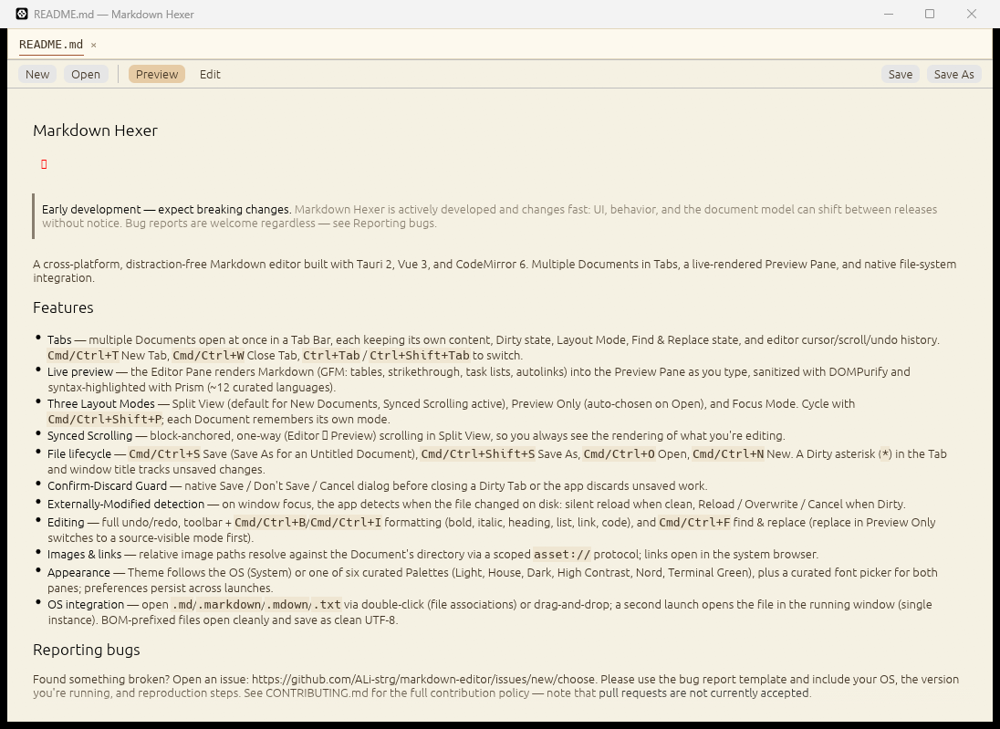
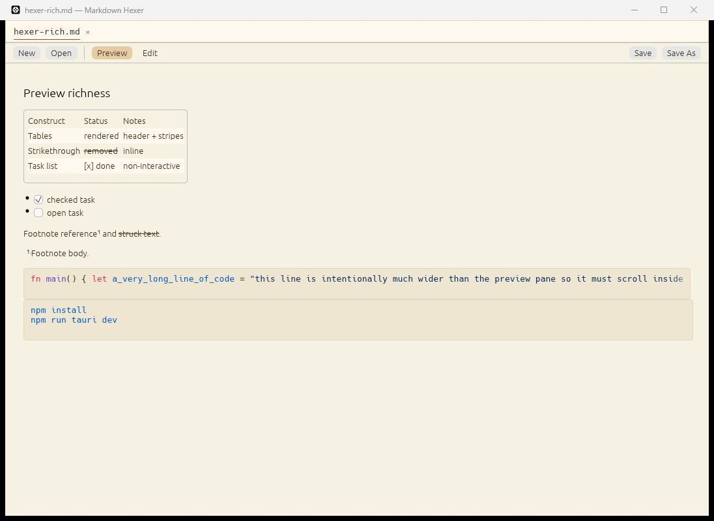

# 2.0 Preview Richness

Ticket 06 verification for the native Preview. Run on Windows 11 with the
Light Palette, `egui` 0.37, and `egui_commonmark` 0.26.

## Result

| Construct | Status | Notes |
|---|---|---|
| GFM tables | Rendered | Header row, body rows, and local horizontal scrolling. `egui_commonmark` draws the grid; header cells are not bold and cells have no borders. |
| Strikethrough | Rendered | `~~text~~` draws a line through the text. |
| Task lists | Rendered | Checked and unchecked boxes. `CommonMarkViewer` uses `ImmutableCheckbox`; boxes are display-only. |
| Footnotes | Rendered | Superscript reference and inline footnote body. No backlink/navigation yet. |
| Fenced code | Rendered by the app | Syntax colors come from the active Palette; the block scrolls horizontally inside its own frame. |
| Inline code | Rendered | Monospaced with `palette.code_bg`; the app already sets `visuals.code_bg_color`. |
| Raw HTML | Dropped | Sanitized before the widget sees the document; a user-written `data-hexer-code` sentinel is stripped too. |
| Malformed Markdown | No panic | Parser and widget tests cover unclosed emphasis, links, fences, HTML, tables, tasks, and footnotes. |

Golden render-tree snapshots live in `app/src/preview.rs`:
`parses_gfm_tables`, `parses_gfm_strikethrough`, `parses_gfm_task_lists`,
`parses_gfm_footnotes`, `keeps_inline_code_monospaced_in_the_tree`,
`replaces_fenced_code_with_sentinels_for_the_renderer`,
`fenced_code_sentinels_are_one_per_code_block`,
`fenced_code_in_containers_gets_sentinels`, and
`drops_user_supplied_code_sentinels_as_raw_html`.

## Horizontal scrolling

The page is one vertical `ScrollArea`. It never gets a horizontal scrollbar.

- Tables: `egui_commonmark` already wraps its `Grid` in
  `ScrollArea::horizontal`, so a wide table scrolls inside the table region.
- Code: the app replaces each fenced block with an HTML sentinel and renders
  that sentinel through `CommonMarkViewer::render_html_fn`. The app-owned block
  uses `ScrollArea::horizontal`, a non-wrapping `Label`, and the Palette
  `CodeTheme`. This also fixes the widget's default wrapping `TextEdit`.
- Focused tests: `code_blocks_scroll_inside_the_page_instead_of_widening_it`
  asserts a 300 px page keeps a code frame at 300 px while the code content is
  wider than 600 px; the existing narrow harness also covers rendered tables.

## Visual check

Native app screenshots, opening a file directly in Preview:



The README fixture preserves heading, blockquote, lists, inline code, links,
the table, and fenced `sh` blocks. Its table and code sections are below the
first viewport; the construct fixture below shows the same constructs at once.



The README fixture is copied to `app/tests/fixtures/readme.md`; the UI test
`readme_fixture_renders_tables_and_code_in_preview` opens it through the real
Preview and finds a table header and rendered code text.

Observations from the visual pass:

- Table text, strikethrough, tasks, footnote body, and fenced code all render.
- Code colors are visibly palette-driven: keyword red, string blue, comment
  gray.
- A long fenced line is clipped at the code frame edge and scrolls locally; the
  page itself stays at the same width.
- The README's `AppReadme.png` is a placeholder because images are ticket 07.
- `→` (U+2192) renders as tofu in the bundled Ubuntu-Light font. Font coverage
  is ticket 12.

## Gaps and follow-ups

- Syntax highlighting uses `egui_extras::syntax_highlighting`'s fallback
  tokenizer, not syntect: it recognizes comments, functions, keywords,
  literals/numbers, strings, punctuation, and whitespace. There is no full
  language grammar.
- Only the Light Palette exists; the syntax tokens are in the Palette so later
  themes can supply their own values.
- Indented code blocks still use the widget default (wrapping, default colors).
  The ticket only requires fenced code.
- Table styling is the widget default: no cell borders and no bold header.
- Task checkboxes are display-only. Footnote references show a superscript but
  do not navigate back to the reference.
- Images and links remain ticket 07; Sections/copy remain tickets 08/09; themes
  and font coverage remain ticket 12.

## Commands

From `app/`:

```text
cargo fmt
cargo test --all-targets       # 113 passed
cargo clippy --all-targets -- -D warnings
cargo build --release
```
